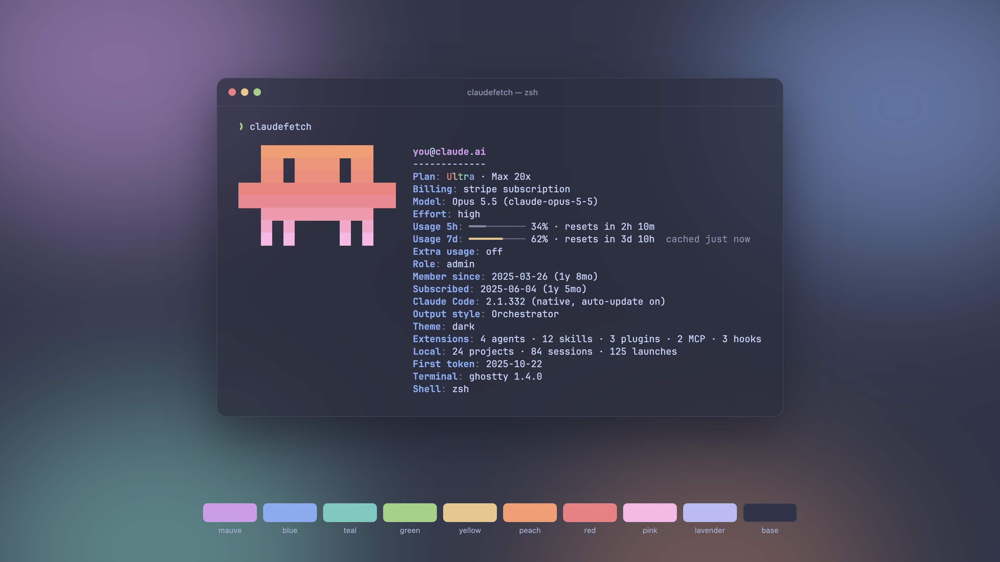

# claudefetch



<sub>Rendered from real claudefetch output against demo data, not a screenshot of a real account.</sub>

A fastfetch-style summary of your local Claude setup: plan, tier, model, usage
(from Claude Code's own cache, no network), Claude Code version, extension
counts, projects and sessions. Python 3, stdlib only, Catppuccin Frappe truecolor.

The plan name runs a rainbow for about two seconds on a TTY, then settles.

Never shown: email address, tokens, account or organisation UUIDs. From the
macOS keychain item `Claude Code-credentials` only `subscriptionType` and
`rateLimitTier` are read.

## Flags

- `--json` print fields as JSON (no colour, no logo)
- `--no-color` plain text (also implied by `NO_COLOR` or a non-TTY stdout)
- `--no-logo` hide the logo
- `--no-anim` static rainbow; `--anim SECONDS` animation length (default 2.0, `0` = off)
- `--title TEXT` title line. Default order: `--title`, `$CLAUDEFETCH_TITLE`, first line of `~/.config/claudefetch/title`, then your display name. A title you set is shown verbatim (the email filter does not apply to it).
- `--version`

`CLAUDEFETCH_NO_ANIM=1` also disables the animation.

## Install

Needs Python 3.9+ (the one macOS ships works) and nothing else. It reads the files Claude Code keeps in
`~/.claude.json` and `~/.claude/`, so sign in to Claude Code first.

One file, straight into `~/.local/bin` (make sure that directory is on your `PATH`):

```bash
mkdir -p ~/.local/bin
curl -fsSL https://raw.githubusercontent.com/amornnan19/claudefetch/main/claudefetch -o ~/.local/bin/claudefetch
chmod +x ~/.local/bin/claudefetch
claudefetch
```

Or clone it and link it, so `git pull` updates it:

```bash
git clone https://github.com/amornnan19/claudefetch.git
cd claudefetch
ln -s "$PWD/claudefetch" ~/.local/bin/claudefetch
```

The title line defaults to your Claude display name. To set your own:

```bash
mkdir -p ~/.config/claudefetch
echo 'you@example.dev' > ~/.config/claudefetch/title
```

Works on macOS and Linux. On macOS the plan and tier also come from the
keychain item Claude Code writes; on Linux from `~/.claude/.credentials.json`.

## Tests

    python3 -m unittest discover -s tests -v

## Preview image

`assets/preview.png` is generated: `scripts/render-preview.py` runs claudefetch
under a pseudo-TTY against a demo HOME, turns its truecolor output into HTML and
screenshots it with `chrome-headless`.

```bash
python3 scripts/render-preview.py
```

## License

MIT, see [LICENSE](LICENSE).
